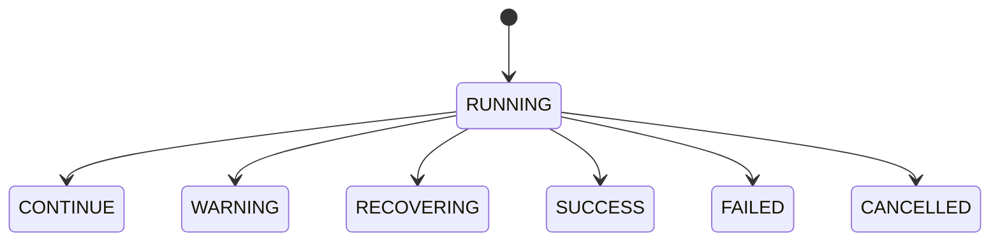
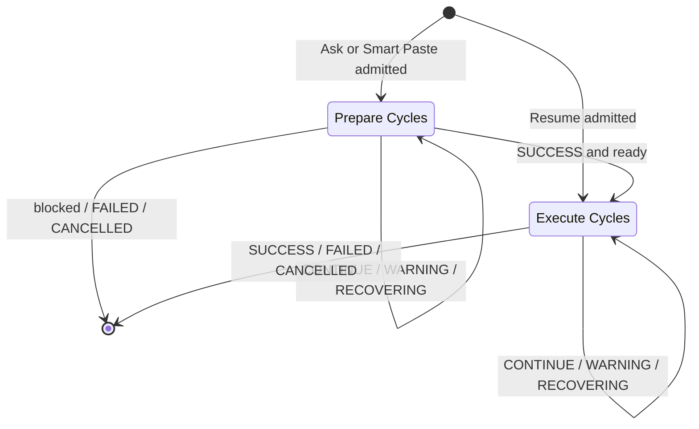
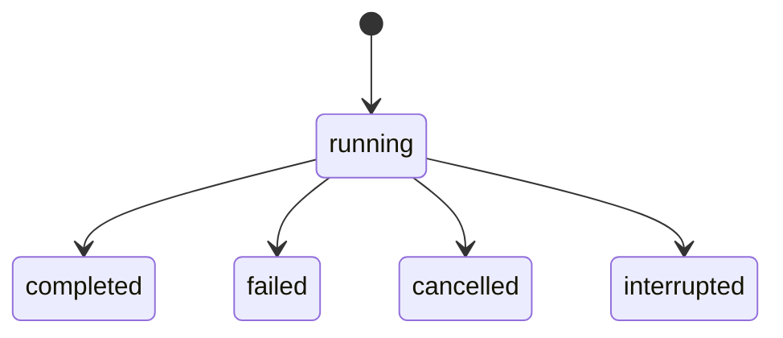
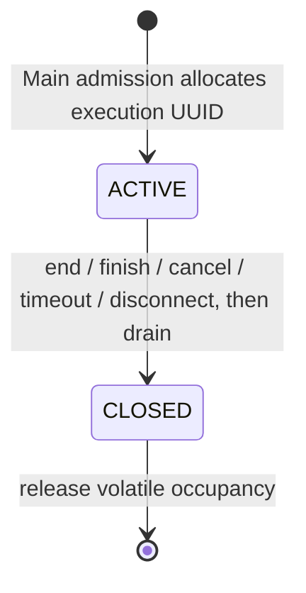
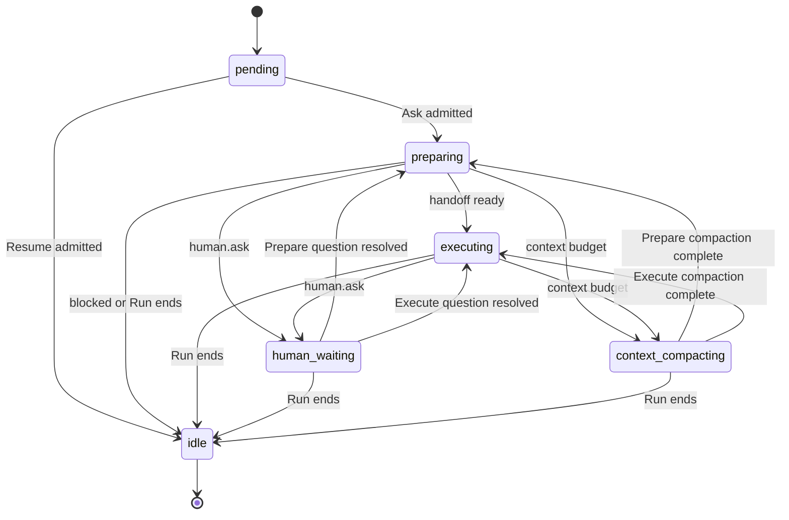

# Unified Agent Runtime

Language: English · [简体中文](agent-runtime.zh-CN.md)

Purpose. Define the shared execution contract for Ask AI, Smart Paste, and desktop Resume V3. Status. **Implemented**.

## 1. Prompt, Run and Cycle

The [Agent Engine](../src/platform/agent/engine/index.ts) runs the trusted [ask and resume definitions](../src/platform/agent/engine/definitions.ts) through one Pi runtime. Chat and Smart Paste use the Ask definition. Desktop Resume runs one Execute stage with scoped tools and an isolated context with read/write Memory and read-only Knowledge. Its Agent Run links to a separate GenerationRun. Its [definition](../src/platform/agent/engine/definitions.ts) skips bullets already rewritten in that generation task and uses request receipts for identical retries. [Resume business states](data-architecture.md#3-generation-output-and-deletion)

[Ask Workflow](../src/platform/agent/engine/ask-workflow.ts) starts with read-only Prepare, which can inspect business data, Knowledge, Memory and prior conversation, and wait for user answers through human.ask. Prepare returns a strictly validated ready or blocked result. Ready passes the original request and a self-contained handoff to Execute. Execute has its own context and Scope expansion and owns final business actions and durable Memory decisions. Blocked ends normally with a visible reason. A protocol error fails the Run. Both stages share model capabilities, one MCP authorization session, RunGuard, protected execution state, numbering and limits. Each Run permits up to 64 model requests including summaries and 256 tool calls.

Chat-only [system instructions](../src/platform/agent/ask.ts) require `human.ask` and waiting for an answer whenever intent, required information, or the next action is uncertain; guessing or asking only in the final response is prohibited. Cancelling a question prevents actions that depend on its answer. This is a model instruction, not runtime detection of uncertainty; Smart Paste and Resume retain their existing instructions.

Ask AI receives read-only Profile and existing artifact operations. Its [prompt](../src/platform/agent/ask.ts), tool lists, Scope directories and model schemas omit Profile and Resume write interfaces. Discovery and execution enforce the [Ask capability policy](mcp-architecture.md#2-registration-and-workflow-contracts).

A Session holds user Prompts. Each new Prompt creates one Run for its top-level task, which can include several requested operations. The same request ID and payload return the existing Run. Prior messages, tool results and context summaries help resolve references. Every new Run starts with fresh execution state, Scope expansion and RunGuard state. It does not resume earlier Runs or dispatch their pending calls.

A Run holds an ordered sequence of ReAct Cycles, indexed from 1. Each Cycle covers one Pi decision, its sequential tool batch, and the observations that determine the next action. A decision can return several tool calls or a final answer. Context compression may invoke the model during a Cycle. Those auxiliary requests have separate diagnostics and never create Cycles. [Main coordination](../src/platform/electron/ask-agent-tasks.ts) and [Pi integration](../src/platform/agent/pi/runtime.ts)

## 2. State and transitions

| Cycle status | Meaning | Execution decision |
| --- | --- | --- |
| `RUNNING` | The current Cycle is open | Wait for settlement |
| `CONTINUE` | The tool round settled normally | Start the next Cycle |
| `WARNING` | RunGuard warning remains active | Start the next Cycle with trusted warning guidance |
| `RECOVERING` | RunGuard recovery remains active | Start the next Cycle with trusted recovery guidance |
| `SUCCESS` | The stage has committed a valid final result | Advance to Execute after ready Prepare, otherwise stop |
| `FAILED` | A fatal runtime error, hard block, or uncertain write stopped execution | Stop |
| `CANCELLED` | The user stopped execution without a known fatal cause | Stop |

A Cycle starts in `RUNNING` and settles once. `CONTINUE` records a normal round and permits another decision. `SUCCESS` settles the current stage. The next Cycle may start only after a ready Prepare handoff. [State machine](../src/platform/agent/react-cycle/machine.ts)

The latest Cycle is a projection independent of the Run lifecycle. A pending Run can end with zero Cycles. An interruption retains the last durable Cycle and is recorded on the Run.

## 3. Execution control and RunGuard

Pi `turn_start` opens the Cycle before model preparation. `finishTurn` resolves the validated response and completed or skipped tool outcomes and stops Pi on a terminal decision. `turn_end` commits a continuing outcome before the next turn can start. The runtime checks permission before model and tool dispatch. A synthetic `turn_end` after preparation failure cannot create a Cycle. [Pi runtime](../src/platform/agent/pi/runtime.ts)

RunGuard owns progress detection and hard blocks. Runtime uses the latest trusted Guard snapshot. Scope discovery or Human Ask preserves an outstanding warning or recovery. A fresh business result can clear it within the same batch. Recovery stops dispatch of the remaining batch, retains the observations already received, and injects guidance into the next request after compaction. The next decision may use another authorized source or answer from confirmed evidence. Normal tool errors become observations. A known fatal cause takes precedence over generic cancellation. [MCP policy](mcp-architecture.md#agent-run-protection)

[Smart Paste](architecture.md#smart-paste-and-global-banner) observes Execute assistant deltas and a host-only Execute tool-turn signal from Pi. The host can retract that turn's temporary field text without altering the recorded conversation or Cycle transitions.

The volatile Guard execution has its own lifecycle below. Main allocates its UUID automatically for internal work or on external Begin. At most one execution is active globally; a competing internal execution fails with `TOOL_BUSY` before model/tool execution. Same-Session queued Prompts keep their existing FIFO. Guard closure waits for started tools and frees admission; business writes remain persisted on failure, cancellation, timeout or disconnect. Resume Controller retains the same occupancy across Agent finalization and business publication/output. [Protocol and authorization](mcp-architecture.md#execution-identity-and-external-protocol)

`executionRunId` identifies Guard snapshots; legacy Trace `agentRunId` fields are normalized by [parseRunGuard](../src/shared/agent/run-guard.ts) on read. Stored Trace is not rewritten. Guard blocking is behavioral protection, never business rollback or a semantic correctness check.

## 4. Finalization and trace

Main commits the Prepare handoff with its successful Cycle before starting Execute. At Run end Main finalizes the last open Cycle and the host Run lifecycle in one transaction with the final transcript. It publishes terminal events after commit. If terminal persistence fails, Main holds that Session's queue while it retries recording the failure. Confirmed writes remain committed. Uncertain writes stop execution and are never replayed automatically. [Main recorder](../src/platform/electron/agent-recorder.ts)

The host lifecycle manages admission, resources, recovery and UI projection. Initialization failure or cancellation before the first turn leaves zero Cycles. A failure or cancellation between Cycles preserves the last settled Cycle. After a process interruption, the host may report `interrupted` while the last Cycle still shows `RUNNING`, the last recorded state before the crash. No work is resumed.

Copy Debug JSON v2 includes the prepared result, phases, ordered Cycles and latest status alongside host lifecycle, model requests, Provider responses and actual tool records. Cycle tool IDs include calls skipped before dispatch. Storage and versioning details live in the [data architecture](data-architecture.md#copy-debug-json).

A completed Resume Agent Run lets the Controller validate and publish the stored document through MCP. Agent final text is a summary for the Trace. A successful Agent Run can be followed by a failed business validation. File output has its own lifecycle. [Resume Controller](../src/platform/electron/resume-tasks.ts)

Resume failure reporting retains supported model, tool, MCP and storage codes through `resume.fail`; unknown causes use `GENERATION_FAILED`. `VALIDATION_FAILED` is reserved for an identified document validation failure, not a semantic assessment of model claims. These codes do not change Run/Cycle transitions. The [Resume definition](../src/platform/agent/engine/definitions.ts), [MCP tools](../src/platform/tools/resume.ts) and [external skill](../skills/tailor-resume/SKILL.md) restrict rewrites to listed bullet IDs and preserve grouped skills within one item bullet; introduction and standalone Skills remain copied text.

The existing recorder persists terminal state atomically. Consola emits terminal diagnostics at execution boundaries without participating in state transitions or finalization. Diagnostic failure cannot change Run/Cycle outcomes; see [data architecture](data-architecture.md#4-transactions-and-terminal-diagnostics).

[ScopedToolset](../src/platform/agent/tools/scoped-toolset.ts) expands independently in each stage. Human Ask pauses the current tool and Cycle with human.waiting. An answer or skip returns to the same stage, as does completed context compaction. Run cancellation invalidates pending questions. [Human protocol](mcp-architecture.md#human-ask)

