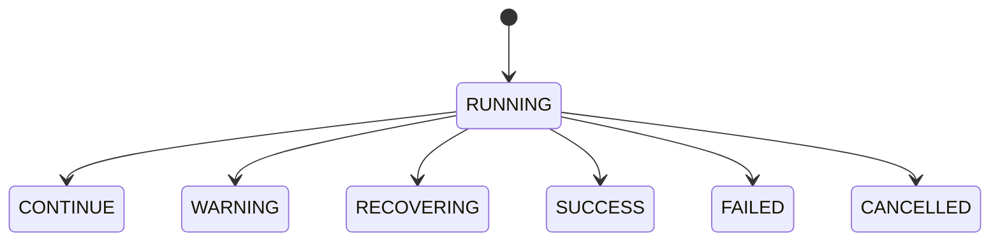
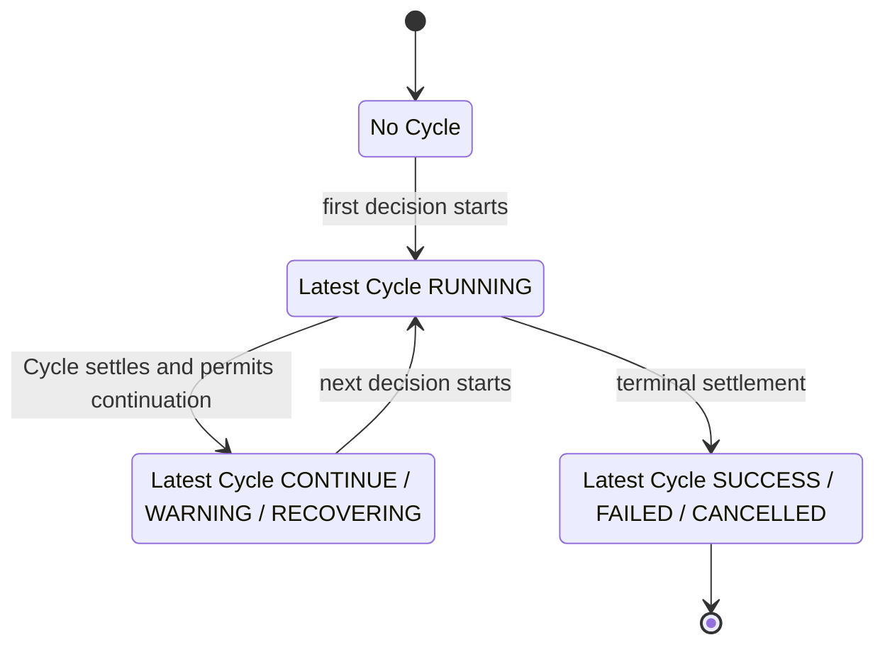

# Ask AI Agent Runtime

Language: English · [简体中文](agent-runtime.zh-CN.md)

Purpose. Define the Ask AI execution contract. Status. **Implemented** for the in-app Ask AI Agent.

## 1. Prompt, Run and Cycle

A Session holds user Prompts. Each new Prompt creates one Run for its top-level task, which can include several requested operations. The same request ID and payload return the existing Run. Prior messages, tool results and context summaries help resolve references. Every new Run starts with fresh execution state, tool activation and RunGuard state. It does not resume earlier Runs or dispatch their pending calls.

A Run holds an ordered sequence of ReAct Cycles, indexed from 1. Each Cycle covers one Pi decision, its sequential tool batch, and the observations that determine the next action. A decision can return several tool calls or a final answer. Context compression may invoke the model during a Cycle. Those auxiliary requests have separate diagnostics and never create Cycles. [Main coordination](../src/platform/electron/ask-agent-tasks.ts) and [Pi integration](../src/platform/agent/pi/runtime.ts)

## 2. State and transitions

| Cycle status | Meaning | Execution decision |
| --- | --- | --- |
| `RUNNING` | The current Cycle is open | Wait for settlement |
| `CONTINUE` | The tool round settled normally | Start the next Cycle |
| `WARNING` | RunGuard warning remains active | Start the next Cycle with trusted warning guidance |
| `RECOVERING` | RunGuard recovery remains active | Start the next Cycle with trusted recovery guidance |
| `SUCCESS` | A valid final answer and host finalization have committed | Stop |
| `FAILED` | A fatal runtime error, hard block, or uncertain write stopped execution | Stop |
| `CANCELLED` | The user stopped execution without a known fatal cause | Stop |

A Cycle starts in `RUNNING` and settles once. `CONTINUE` records a normal round and permits another decision. `SUCCESS` is the terminal outcome of a completed Run. [State machine](../src/platform/agent/react-cycle/machine.ts)

Run status is derived from the latest Cycle. With no Cycles it is `null`. The Run diagram groups the three outcomes that permit a new Cycle. For example, a Run can move from `WARNING` through a new `RUNNING` Cycle to `SUCCESS`, while the earlier warning remains recorded.

## 3. Execution control and RunGuard

Pi `turn_start` opens the Cycle before model preparation. `finishTurn` resolves the validated response and completed or skipped tool outcomes and stops Pi on a terminal decision. `turn_end` commits a continuing outcome before the next turn can start. The runtime checks permission before model and tool dispatch. A synthetic `turn_end` after preparation failure cannot create a Cycle. [Pi runtime](../src/platform/agent/pi/runtime.ts)

RunGuard owns progress detection and hard blocks. Runtime uses the latest trusted Guard snapshot. Discovery or activation preserves an outstanding warning or recovery. A fresh business result can clear it within the same batch. Recovery stops dispatch of the remaining batch, retains the observations already received, and injects guidance into the next request after compaction. The next decision may use another authorized source or answer from confirmed evidence. Normal tool errors become observations. A known fatal cause takes precedence over generic cancellation. [MCP policy](mcp-architecture.md#ask-run-protection)

## 4. Finalization and trace

Main finalizes the last open Cycle and the host Run lifecycle in one transaction with the final transcript. It publishes terminal events after commit. If terminal persistence fails, Main holds that Session's queue while it retries recording the failure. Confirmed writes remain committed. Uncertain writes stop execution and are never replayed automatically. [Main recorder](../src/platform/electron/ask-agent-recorder.ts)

The host lifecycle manages admission, resources, recovery and UI projection. Initialization failure or cancellation before the first turn leaves zero Cycles. A failure or cancellation between Cycles preserves the last settled Cycle. After a process interruption, the host may report `interrupted` while the last Cycle still shows `RUNNING`, the last recorded state before the crash. No work is resumed.

Copy Debug JSON v2 includes the ordered Cycles and latest status alongside host lifecycle, model requests, Provider responses and actual tool records. Cycle tool IDs include calls skipped before dispatch. Storage and versioning details live in the [data architecture](data-architecture.md#copy-debug-json).

The MVP covers a single Prompt within one Ask AI Run. Cross-Prompt workflows, a separate recovery Agent and a visual Cycle debugger remain outside this contract.
