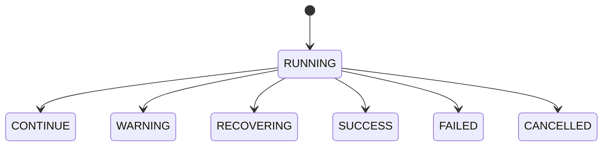
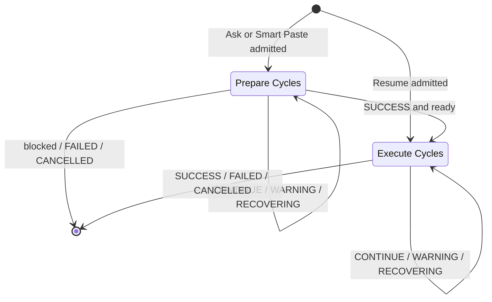
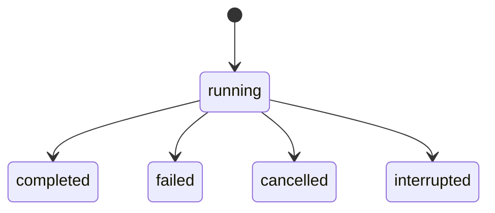
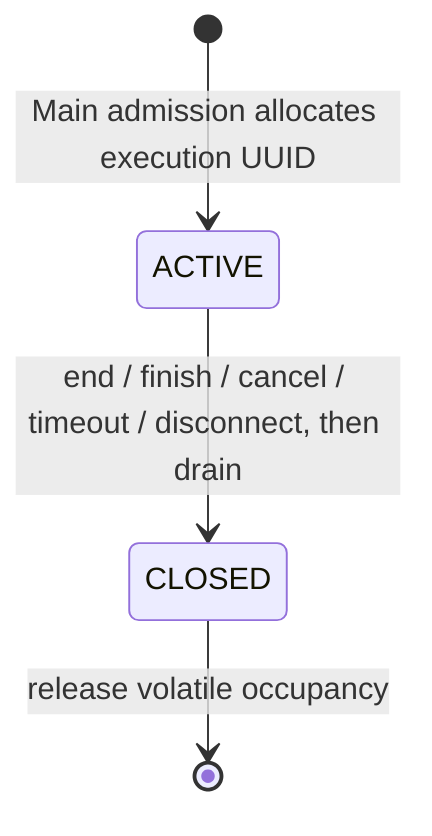
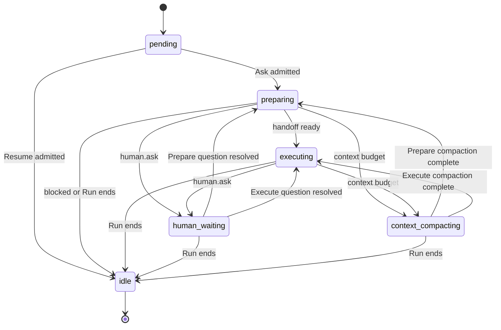

# 统一 Agent 运行时

语言：简体中文 · [English](agent-runtime.md)

用途。定义 Ask AI、智能粘贴和桌面 Resume V3 的共享执行契约。状态。**已实现**。

## 一、Prompt、Run 与 Cycle

[Agent Engine](../src/platform/agent/engine/index.ts)用唯一的 Pi 运行时执行受信任的 [ask 和 resume 定义](../src/platform/agent/engine/definitions.ts)。聊天和智能粘贴使用 Ask 定义。桌面 Resume 只运行 Execute，使用 Scope 工具、隔离上下文、可读写 Memory 和只读 Knowledge。其 Agent Run 关联独立的 GenerationRun。其[定义](../src/platform/agent/engine/definitions.ts)跳过本次生成任务中已经改写的要点，相同重试使用请求回执。[Resume 业务状态](data-architecture.zh-CN.md#三生成成品与删除)

[Ask Workflow](../src/platform/agent/engine/ask-workflow.ts)先执行只读 Prepare，可查询业务资料、Knowledge、Memory 和历史，也可通过 human.ask 等待用户回答。Prepare 输出严格校验的 ready 或 blocked。ready 将原始请求和自包含的交接内容传给 Execute。Execute 使用独立上下文和 Scope 展开，并负责最终业务操作和长期 Memory 决策。blocked 正常结束并显示原因，协议错误使 Run 失败。两阶段共享模型能力、一个 MCP 授权会话、RunGuard、Protected State、编号及预算。每 Run 最多 64 次模型请求（含摘要）和 256 次工具调用。

仅聊天入口的[系统指令](../src/platform/agent/ask.ts)要求在用户意图、所需信息或下一步操作存在疑问时，必须调用 `human.ask` 并等待回答，禁止猜测或仅在最终回复中提问。用户取消问题后，不得继续依赖该答案的操作。这是模型指令，不是运行时疑问检测；智能粘贴和 Resume 保持现有指令。

Ask AI 仅获得 Profile 和已有成品的只读操作。其[提示词](../src/platform/agent/ask.ts)、工具列表、Scope 目录及模型 Schema 均不列出 Profile 和 Resume 写入接口。工具发现与执行遵守 [Ask 能力策略](mcp-architecture.zh-CN.md#二注册与流程契约)。

Session 包含用户 Prompt。每个新 Prompt 创建一个 Run，负责该 Prompt 的顶层任务，可包含多项明确要求的操作。相同请求 ID 和载荷返回原 Run。历史消息、工具结果和上下文摘要帮助理解引用。每个新 Run 都有独立的执行状态、Scope 展开和 RunGuard 状态，旧 Run 及其待执行调用不会继续运行。相关入口见 [Main 协调器](../src/platform/electron/ask-agent-tasks.ts)和 [Pi 接入](../src/platform/agent/pi/runtime.ts)。

Run 包含按序排列的 ReAct Cycle，编号从 1 开始。每个 Cycle 覆盖一次 Pi 决策、串行工具批次，以及决定后续动作的观察结果。一次决策可以返回多个工具调用，也可以给出最终回答。Cycle 内的上下文压缩可调用模型。这些辅助请求有独立诊断，不产生 Cycle。

## 二、状态与转换

| Cycle 状态 | 含义 | 执行决策 |
| --- | --- | --- |
| `RUNNING` | 当前 Cycle 尚未结算 | 等待结算 |
| `CONTINUE` | 工具轮正常结算 | 启动下一 Cycle |
| `WARNING` | RunGuard 警告仍生效 | 下一 Cycle 带可信警告指导 |
| `RECOVERING` | RunGuard 恢复仍生效 | 下一 Cycle 带可信恢复指导 |
| `SUCCESS` | 本阶段的有效结果已提交 | Prepare 返回 ready 时进入 Execute，其余情况停止 |
| `FAILED` | 致命运行时错误、硬阻断或不确定写入使执行停止 | 停止 |
| `CANCELLED` | 用户停止执行，且没有已知致命原因 | 停止 |

Cycle 从 `RUNNING` 开始，只结算一次。`CONTINUE` 记录普通工具轮，允许再次决策。`SUCCESS` 结算当前阶段。Prepare 返回 ready 后可开启 Execute Cycle。见[状态机](../src/platform/agent/react-cycle/machine.ts)。

最近 Cycle 是独立于 Run 生命周期的投影。待运行任务可在没有 Cycle 的情况下结束。中断保留最后一次持久化的 Cycle，并记录在 Run 上。

## 三、执行控制与 RunGuard

Pi 的 `turn_start` 在准备模型请求前创建 Cycle。`finishTurn` 根据已校验响应及工具完成或跳过的结果作出决策，遇到终止决策即停止 Pi。`turn_end` 在下一轮开始前提交继续类结果。派发模型请求和工具前均检查执行许可。准备失败时产生的合成 `turn_end` 不会创建 Cycle。见 [Pi 运行时](../src/platform/agent/pi/runtime.ts)。

RunGuard 负责进展检测和硬阻断。运行时使用最后一个可信 Guard 快照。Scope 或 Human Ask 会保留尚未解除的警告或恢复状态。同批次取得新业务证据时可以清除该状态。触发恢复时停止派发当前批次的剩余调用，保留已收到的观察结果，并在下一轮压缩完成后注入指导。下一轮可以使用其他已授权数据源，或依据已确认信息回答。普通工具错误作为观察结果。已知致命原因优先于通用取消。见 [MCP 策略](mcp-architecture.zh-CN.md#agent-run-保护)。

[智能粘贴](architecture.zh-CN.md#智能粘贴与全局通知) 仅观察 Execute 的助手增量及 Pi 向宿主发送的 Execute 工具轮信号。宿主可撤回该轮的临时字段文本，会话记录与 Cycle 转换沿用现有规则。

内存中的 Guard 执行使用下述独立生命周期。Main 为内部工作自动分配 UUID，外部执行通过 Begin 申请。全局最多一个活动执行；竞争的内部执行在模型/工具执行前返回 `TOOL_BUSY`。同 Session 排队的 Prompt 保留原有 FIFO。Guard 关闭会等待已开始的工具，随后释放准入；失败、取消、超时或断连都保留业务写入。Resume Controller 在 Agent 收尾、业务发布和输出期间保留同一次占用。[协议与鉴权](mcp-architecture.zh-CN.md#执行身份与外部协议)

`executionRunId` 标识 Guard 快照；历史 Trace 的 `agentRunId` 字段由 [parseRunGuard](../src/shared/agent/run-guard.ts)在读取时规范化，不改写已保存 Trace。Guard 阻断仅承担行为防护，不回滚业务，也不判断语义正确性。

## 四、收尾与诊断

Main 在启动 Execute 前提交交接结果及成功的 Prepare Cycle。Run 结束时，Main 在同一事务中结算最后一个未关闭的 Cycle，并保存宿主 Run 生命周期和最终会话内容。事务提交后发布终态事件。终态持久化失败时，Main 保持该 Session 的队列屏障，重试保存失败结论。已确认写入继续有效，不确定写入会停止执行且不会自动重放。见 [Main 记录器](../src/platform/electron/agent-recorder.ts)。

宿主生命周期管理放行、资源、恢复和界面投影。首轮开始前初始化失败或取消时，Cycle 列表为空。两轮之间失败或取消时，保留上一条已结算 Cycle。进程中断后宿主可以标记 `interrupted`，而最后一个 Cycle 保持 `RUNNING`，即崩溃前最后写入的状态。工作不会恢复执行。

Copy Debug JSON v2 包含交接结果、阶段、按序排列的 Cycle 和最新状态，同时保留宿主生命周期、模型请求、Provider 响应及实际工具记录。Cycle 的工具 ID 也包含派发前跳过的调用。存储和版本规则见[数据架构](data-architecture.zh-CN.md#copy-debug-json)。

Resume Agent Run 完成后，Controller 通过 MCP 校验并发布已持久化的文档。Agent 最终文本作为 Trace 摘要。Agent Run 完成后业务校验仍可能失败。文件输出具有独立生命周期。[Resume Controller](../src/platform/electron/resume-tasks.ts)

Resume 失败报告通过 `resume.fail` 保留受支持的模型、工具、MCP 和存储错误码；未知原因使用 `GENERATION_FAILED`。`VALIDATION_FAILED` 仅用于已确认的文档校验失败，不代表模型主张的语义判断。这些错误码不改变 Run/Cycle 转换。[Resume 定义](../src/platform/agent/engine/definitions.ts)、[MCP 工具](../src/platform/tools/resume.ts)和[外部 Skill](../skills/tailor-resume/SKILL.zh-CN.md)只允许改写列表返回的要点 ID，条目要点中的成组技能保留为一条；个人简介和独立 Skills 沿用复制的原文。

终态由现有 Recorder 原子持久化；Consola 仅在执行边界输出终端诊断，不参与状态转换或最终提交。诊断失败不会改变 Run/Cycle 结果；详见[数据架构](data-architecture.zh-CN.md#四事务与终端诊断)。

[ScopedToolset](../src/platform/agent/tools/scoped-toolset.ts)每个阶段独立展开。Human Ask 暂停当前工具和 Cycle，显示 human.waiting，回答或跳过后继续原阶段。上下文压缩结束后也回到原阶段。Run 取消会使等待的问题失效。[人工输入协议](mcp-architecture.zh-CN.md#human-ask)

